# Portfolio

My personal portfolio showcasing projects in web development, UX, and interactive experiences.

**Live site:** [jochempunt.com](https://jochempunt.com/)

## Development

The Astro app lives in `portfolio/`. Use pnpm from that folder:

```bash
cd portfolio
pnpm install --frozen-lockfile
pnpm dev
```

Run `pnpm build` to generate the site in `portfolio/dist/` (relative to the repository root).

## Built with
- **Astro** - Static site generation
- **MDX** - Project pages generated from markdown with frontmatter
- **CSS** - Custom responsive styling, no frameworks

## Performance (Lighthouse)

